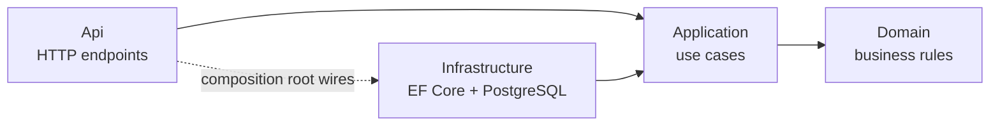
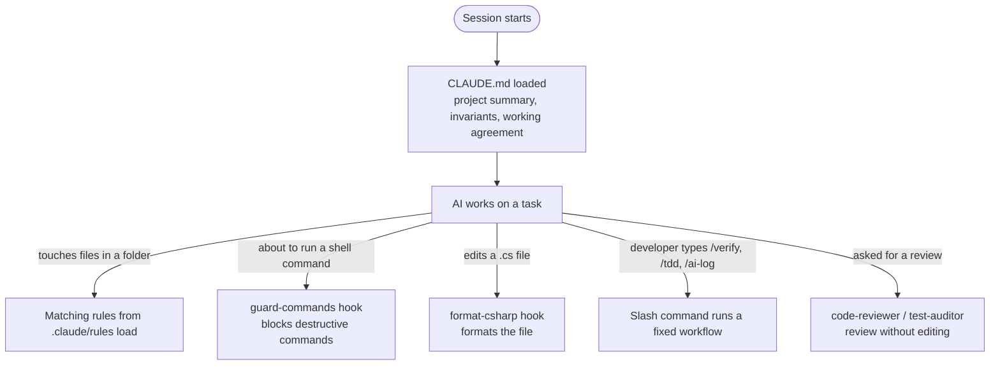

# Project Structure Guide

What every folder and file in this repository is for, and how the pieces work together.
Read this first if you are new to the codebase.

The repository has three parts:

| Part | Folders | Purpose |
|---|---|---|
| **Product code** | `src/`, `tests/` | The scheduling service and its test suites |
| **Documentation** | `docs/`, `README.md` | Design, decisions, edge cases, AI collaboration evidence |
| **AI agent configuration** | `CLAUDE.md`, `.claude/` | Instructions and guardrails that make AI-generated code follow this project's standards |

```
unified-service-scheduler/
├── CLAUDE.md                     AI: main instructions, loaded every session
├── README.md                     Entry point for humans: run, test, AI narrative
├── ServiceScheduler.slnx         .NET solution file
├── Directory.Build.props         Build settings shared by all projects
├── global.json                   Pins the .NET SDK version
├── .editorconfig                 Code style used by the IDE, the build and the formatter
├── .gitattributes / .gitignore   Git line endings and ignored files
│
├── src/                          Product code (Clean Architecture layers)
│   ├── ServiceScheduler.Domain
│   ├── ServiceScheduler.Application
│   ├── ServiceScheduler.Infrastructure
│   └── ServiceScheduler.Api
├── tests/
│   ├── ServiceScheduler.UnitTests
│   └── ServiceScheduler.IntegrationTests
│
├── docs/
│   ├── system-design.md          The design document required by the brief
│   ├── project-structure.md      This file
│   ├── edge-cases.md             Edge-case catalogue; drives the test suite
│   ├── ai-log.md                 Record of AI interactions
│   └── adr/                      Architecture Decision Records
│
└── .claude/                      AI agent configuration
    ├── settings.json             Permissions and hooks
    ├── rules/                    Engineering standards, loaded by folder
    ├── commands/                 Slash commands: /verify, /tdd, /ai-log
    ├── agents/                   Review subagents
    └── hooks/                    Scripts that run automatically on AI actions
```

---

## 1. Product code

### Clean Architecture layers



Arrows are project references. They only point inward: the Domain knows nothing about databases or HTTP,
so the business rules can be tested in milliseconds and cannot be broken by infrastructure changes.

| Project | Contains | Depends on | Example (planned) |
|---|---|---|---|
| `ServiceScheduler.Domain` | Aggregates, value objects, domain services, domain errors | Nothing | `Appointment`, `TimeSlot`, `SlotAllocator` |
| `ServiceScheduler.Application` | One handler per use case; interfaces ("ports") for persistence | Domain | `BookAppointmentHandler`, `IAppointmentRepository` |
| `ServiceScheduler.Infrastructure` | `DbContext`, migrations, repository implementations, DB error translation | Application | `AppointmentRepository`, exclusion-constraint migration |
| `ServiceScheduler.Api` | Minimal API endpoints, request/response contracts, error mapping, DI setup | Application, Infrastructure | `POST /api/appointments` |

### Test projects

| Project | Tests | Needs |
|---|---|---|
| `ServiceScheduler.UnitTests` | Domain rules and handlers, with fakes for the ports | Nothing; runs in seconds |
| `ServiceScheduler.IntegrationTests` | Real database behaviour, HTTP endpoints, idempotency, the concurrency test | Docker (PostgreSQL via Testcontainers) |

Integration tests use real PostgreSQL on purpose: the double-booking guard is a PostgreSQL exclusion
constraint, which an in-memory database cannot reproduce.

### Root build files

| File | Purpose |
|---|---|
| `ServiceScheduler.slnx` | Solution file (the XML format introduced with .NET 10) listing all six projects |
| `Directory.Build.props` | Applied to every project: nullable enabled, warnings are errors, latest analyzers, code style enforced at build |
| `global.json` | Uses .NET SDK 10.0.x so every machine builds with the same toolchain |
| `.editorconfig` | Formatting and naming rules; the IDE, `dotnet format` and the formatting hook all read it |
| `.gitattributes` | Normalises line endings; keeps scripts (`.mjs`, `.sh`) as LF so they run on every OS |
| `.gitignore` | Build output plus personal Claude files (`.claude/settings.local.json`, `CLAUDE.local.md`) |

---

## 2. Documentation (`docs/`)

| File | What it is | When it changes |
|---|---|---|
| `system-design.md` | The design document required by the brief: diagram, components, data flow, technology choices, observability, GenAI usage | During design; whenever a decision changes |
| `edge-cases.md` | Table of edge cases (EC-01 … EC-21) with the expected outcome and the test that covers it | A new rule or edge case is found; a test is written (fill the **Test** column) |
| `adr/` | Architecture Decision Records: context, decision, alternatives, consequences | A significant decision is made or reversed |
| `ai-log.md` | Dated entries: what the AI was asked, what it produced, what was accepted or rejected, how it was verified | After a notable AI interaction (use `/ai-log`) |
| `project-structure.md` | This guide | When folders or tooling change |

Current ADRs:

- **ADR-0001:** The database enforces "no double-booking" (exclusion constraints, not application locks).
- **ADR-0002:** Scope and business assumptions (who books, auto-allocation, slot granularity, out-of-scope items).

---

## 3. AI agent configuration (`CLAUDE.md` + `.claude/`)

The brief evaluates *how the AI was directed and verified*. These files are that direction, written down
and enforced, rather than repeated in every prompt.

### How the pieces fit together



| Mechanism | Triggered by | Purpose |
|---|---|---|
| `CLAUDE.md` | Every session start | The always-on essentials |
| `rules/*.md` | The AI reading or editing files matching the rule's `paths:` | Detailed standards, loaded only when relevant to keep context focused |
| `commands/*.md` | The developer typing `/name` | Repeatable workflows with a fixed procedure |
| `agents/*.md` | The developer, or the main agent delegating | Independent review in a separate context |
| `hooks/*` + `settings.json` | Automatically, on tool events | Guarantees that do not depend on the AI remembering a rule |

### `CLAUDE.md`

Loaded into every session, so it is kept short. It contains:

- What the service does, with links to the design docs
- Build, test and format commands
- The four layers and the dependency rule
- **Four invariants:** no double-booking, the whole duration must fit, UTC time, cancelled appointments free their slot
- An index of the rule files
- **Working agreement:** plan first, test first, `/verify` before claiming done, ask before adding packages or changing the API

### `.claude/rules/`

Each file starts with a `paths:` header listing the folders it applies to.

| Rule file | Loads for | Key content |
|---|---|---|
| `architecture.md` | `src/**` | Layer responsibilities; DDD aggregates, value objects, domain service; why cross-aggregate overlap is enforced by the database; one handler per use case; no MediatR/AutoMapper |
| `booking-domain.md` | Domain, Application, tests | The business rules: validation and error names, technician/bay eligibility, half-open overlap, validation order, service vs buffer intervals, allocation policy (best-fit bay and technician, 3 retries, 7-day alternatives), cancellation, time zones and DST, idempotency, out-of-scope list |
| `csharp-design.md` | All `.cs` files | SOLID applied pragmatically, DRY with the rule of three, the allowed patterns (Result, Strategy, Repository, Factory, Options), immutability, nullability, naming |
| `async-concurrency.md` | `src/**/*.cs`, integration tests | No blocking on async, cancellation tokens everywhere, `DbContext` is not thread-safe, DI lifetimes, a table of race conditions and their guards, `TimeProvider` |
| `persistence.md` | Infrastructure, integration tests | Avoiding N+1, `AsNoTracking`, projections, bounded queries, connection pooling, short transactions, exclusion constraints, `23P01` translation, migration rules, parameterised SQL |
| `api-conventions.md` | Api, integration tests | Routes and status codes, contract records, validation split (shape vs business), RFC 9457 ProblemDetails, idempotency, security baseline |
| `errors-logging-observability.md` | `src/**/*.cs` | Result vs exceptions, global exception handler, structured logging and log levels, no personal data in logs, OpenTelemetry traces, business metrics, health checks |
| `testing.md` | `tests/**` | The TDD loop, what goes in unit vs integration tests, no InMemory/SQLite for persistence, naming, builders, `FakeTimeProvider`, the mandatory concurrency test |

### `.claude/commands/`

| Command | What it does |
|---|---|
| `/verify` | Build → unit tests → integration tests (if Docker is running) → format check. Reports pass / fail / **skipped** honestly; never fixes anything unasked |
| `/tdd <behaviour>` | Finds the edge case, writes the smallest failing test, runs it red, then **stops for review** before implementing |
| `/ai-log <what happened>` | Appends a structured entry to `docs/ai-log.md`; unknown fields are written as "TBD", never invented |

### `.claude/agents/`

Both agents review and report; neither edits files.

| Agent | Use it | Checks |
|---|---|---|
| `code-reviewer` | After a feature, before committing | Booking invariants → concurrency → data access (N+1) → async → layering → error handling → missing tests. Each finding has severity, `file:line`, a failure scenario and a fix |
| `test-auditor` | After a batch of tests | Maps every row of `edge-cases.md` to real tests and asks "would this test fail if the rule were broken?" Reports covered / weak / missing |

### `.claude/settings.json` and `.claude/hooks/`

**Permissions:** read-only and build commands (`dotnet build/test/format`, `git status/diff/log`) run
without prompting; reading `.env` and `secrets.json` is denied.

**Hooks:**

| Hook | Event | Behaviour |
|---|---|---|
| `guard-commands.mjs` | Before any shell command | Blocks force-push, `git reset --hard`, `git clean -f`, `--no-verify`, recursive delete of root/home/parent folders, `dotnet ef database drop`, Docker prune. Normal commands pass through |
| `format-csharp.mjs` | After editing a `.cs` file | Runs `dotnet format whitespace` on that one file (about 1.5 s). Reports failures but never blocks |

Hooks are written in Node.js so they behave the same on Windows, macOS and Linux.

**Activation:** project settings load when a Claude Code session starts **in this folder**.
Review them anytime with the `/hooks` command.

---

## 4. A typical change, end to end

1. Developer: *"Add the rule that bookings must fit inside opening hours."*
2. `CLAUDE.md` requires a plan first; the AI names the edge cases (EC-03, EC-11) and waits for approval.
3. `/tdd` writes a failing unit test; `booking-domain.md` and `testing.md` load automatically because the
   AI is working in Domain and tests.
4. After approval the AI implements the rule in Domain; the formatting hook tidies each edited file.
5. `/verify` runs build, tests and format checks.
6. The `code-reviewer` agent reviews the diff; findings are fixed or rejected with a reason.
7. `edge-cases.md` gets the test name; a notable moment (e.g. the AI's first version missed DST) goes into `/ai-log`.

---

## 5. Where to look

| I want to… | Go to |
|---|---|
| Understand the business rules | `.claude/rules/booking-domain.md` |
| See why a design choice was made | `docs/adr/` |
| Find which test covers a scenario | `docs/edge-cases.md` |
| Run or test the service | `README.md` |
| Change the AI's standards | `.claude/rules/` (detail) or `CLAUDE.md` (always-on essentials) |
| Stop or change an automatic behaviour | `.claude/settings.json` (or `/hooks` in Claude Code) |
