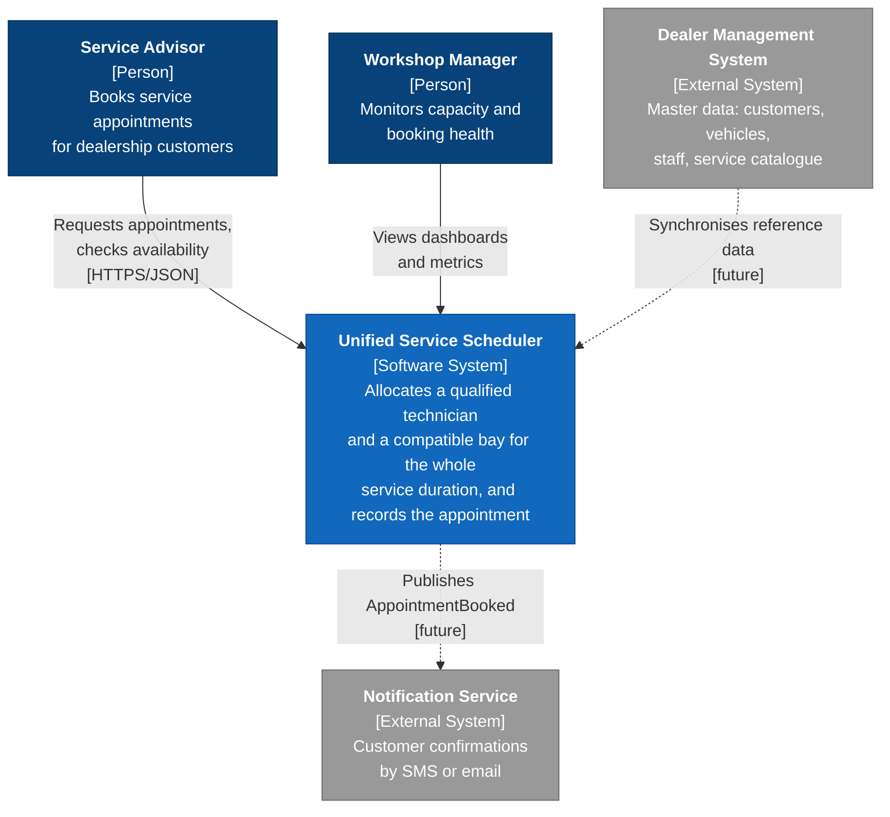
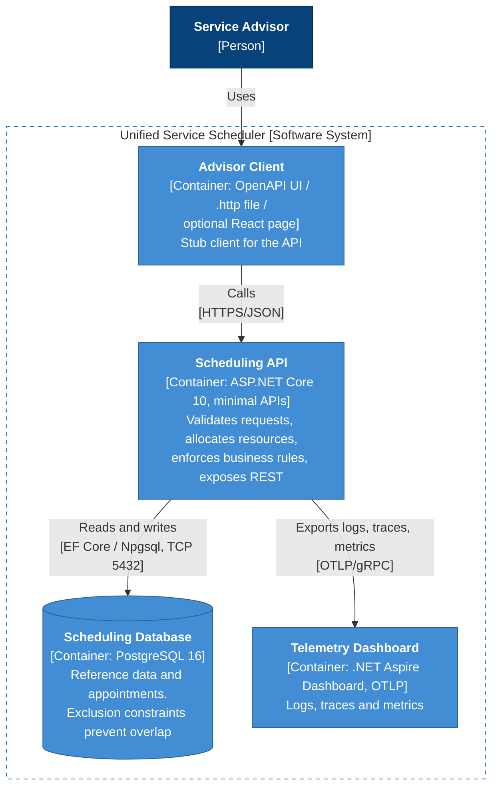
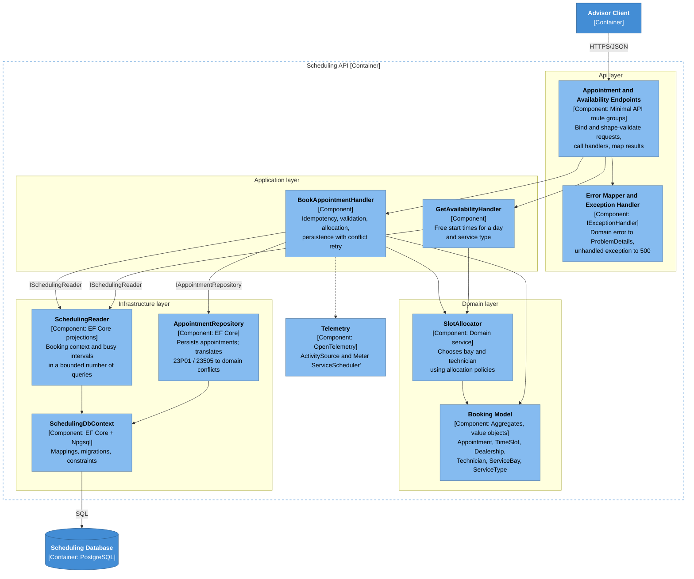
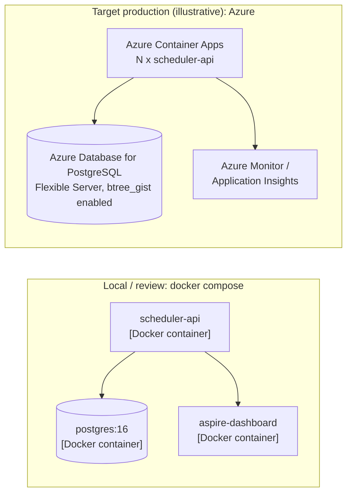
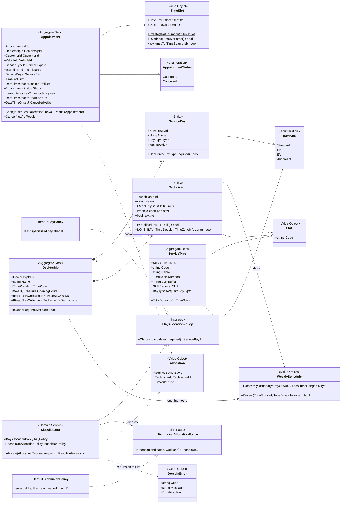
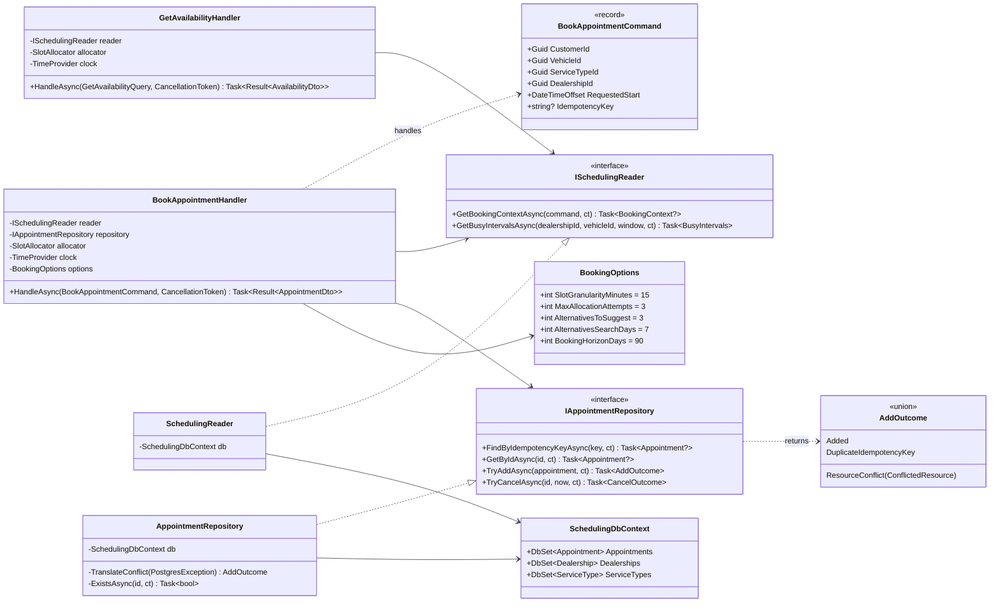
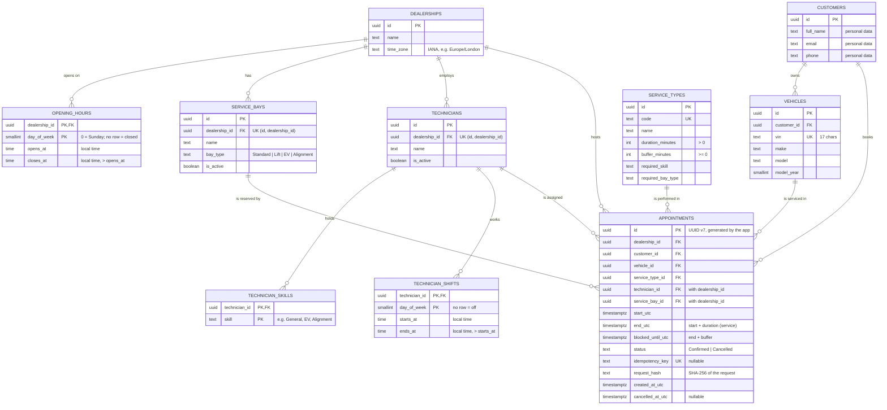
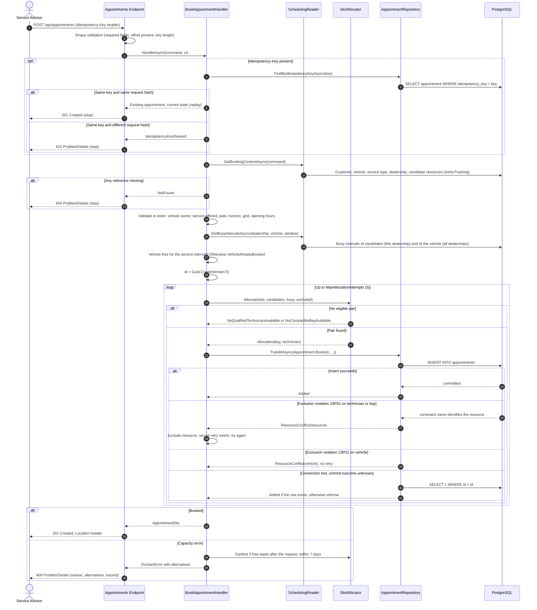
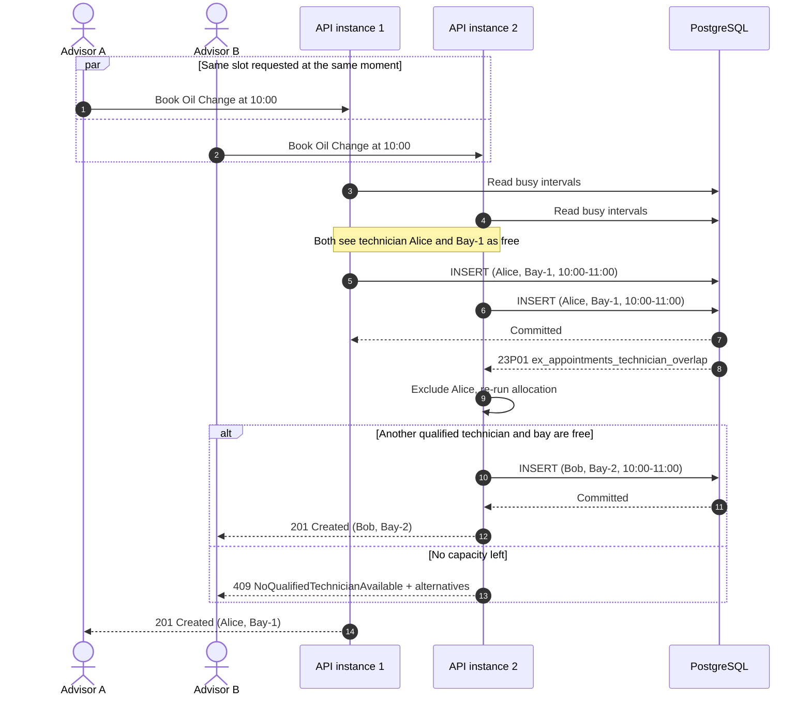
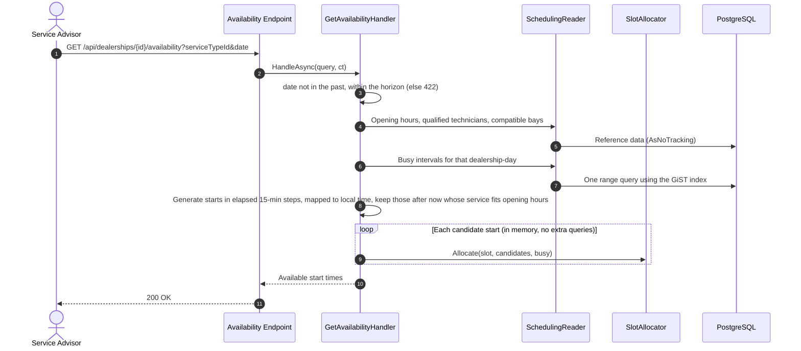

# System Design: Unified Service Scheduler

| | |
|---|---|
| **Scenario** | A: The Unified Service Scheduler (Ownership domain) |
| **Implemented layer** | Backend (REST API + PostgreSQL). Client represented by an OpenAPI contract, a `.http` file and an optional thin demo page |
| **Status** | v1.0. Assumptions in [ADR-0002](adr/0002-scope-and-business-assumptions.md) *Accepted* provisionally, to be revisited after testing; edge cases in the [catalogue](edge-cases.md) |

**Contents**

1. [Problem and scope](#1-problem-and-scope)
2. [Assumptions](#2-assumptions)
3. [Architecture (C4 model)](#3-architecture-c4-model)
4. [Components and responsibilities](#4-components-and-responsibilities)
5. [Domain model (class diagrams)](#5-domain-model-class-diagrams)
6. [Data model (database diagram)](#6-data-model-database-diagram)
7. [Data flow (sequence diagrams)](#7-data-flow-sequence-diagrams)
8. [Concurrency and consistency](#8-concurrency-and-consistency)
9. [API contract](#9-api-contract)
10. [Technology choices](#10-technology-choices)
11. [Observability](#11-observability)
12. [Scalability, performance and reliability](#12-scalability-performance-and-reliability)
13. [How GenAI was used in the design phase](#13-how-genai-was-used-in-the-design-phase)
14. [Future work](#14-future-work)

---

## 1. Problem and scope

### Business problem

Dealership service departments still book work by phone, paper and spreadsheets. The result is
double-booked bays, jobs given to technicians who are not certified for them, and idle capacity
elsewhere in the day. Every lost workshop hour is lost revenue.

### Requirements (from the brief)

| # | Requirement | How this design meets it |
|---|---|---|
| R1 | **Resource-constrained booking**: request an appointment for a vehicle, service type and dealership at a desired time | `POST /api/appointments` with `customerId`, `vehicleId`, `serviceTypeId`, `dealershipId`, `requestedStart` |
| R2 | **Real-time availability check** of both a service bay **and** a qualified technician for the **entire** duration | Synchronous allocation at request time; whole-interval checks against shifts, opening hours and existing bookings; final guarantee by database exclusion constraints |
| R3 | **Confirmed appointment record** associating customer, vehicle, technician and bay | `appointments` row with all four foreign keys, status `Confirmed`, stored UTC interval |

### Non-functional goals

- **Correct under concurrency**: no double-booking even with many simultaneous requests and several API instances.
- **Explainable rejections**: the advisor learns *why* a slot failed and gets alternatives.
- **Observable**: every booking decision can be traced and measured.
- **Simple to run**: `docker compose up`; tests run against real PostgreSQL.

### Out of scope

Authentication, notifications, payments, rescheduling, multi-technician or multi-day jobs, technician
leave, customer self-service portal. See [§14](#14-future-work) for how the design accommodates them.

---

## 2. Assumptions

Full rationale in [ADR-0002](adr/0002-scope-and-business-assumptions.md).

| Area | Assumption |
|---|---|
| User | A **service advisor** books on behalf of the customer through an internal tool |
| Allocation | The **system** picks technician and bay; the advisor does not. **Best fit** for both: least specialised bay, then technician with the fewest skills, then least loaded |
| Unavailable time | `409` with the reason and the **earliest 3 free start times** after the requested one, up to **7 days** ahead |
| Never possible | No compatible bay or no skilled technician at the dealership at all → `422 ServiceNotOfferedAtDealership` |
| Duration | Service duration from the service type, plus an optional buffer (default 0). The **service** must fit opening hours and the shift; the **buffer** may run past closing and blocks only technician and bay. Both instants stored at booking time |
| Granularity | Start times on a **15-minute grid** of the local wall clock |
| Horizon | Bookings up to **90 days** ahead |
| Calendars | One opening range per weekday per dealership; one shift range per weekday per technician; no leave, holidays, split shifts or breaks |
| Bay compatibility | A `Standard` job can use any bay; `Lift`, `EV` and `Alignment` jobs need that bay type |
| Lifecycle | `Confirmed → Cancelled` only; cancel is idempotent and refused once the appointment has started |
| Time | Stored in UTC; opening hours and shifts evaluated in the dealership's IANA time zone; appointments do not span local midnight |
| Reference data | Customers, vehicles, dealerships, bays, technicians and service types are seeded locally; in production they would be synchronised from the Dealer Management System |

---

## 3. Architecture (C4 model)

The [C4 model](https://c4model.com) describes the system at four zoom levels. Each level below zooms
into one box of the level above. Diagrams use C4 notation and colours, drawn with Mermaid.

**Legend:** dark blue = person · blue = this system / its containers · light blue = components ·
grey = external system · dashed = future, not built in this assessment.

### Level 1: System context

Who uses the scheduler and what it talks to.



### Level 2: Containers

The separately deployable or runnable parts of the system.



| Container | Technology | Responsibility | Scales by |
|---|---|---|---|
| Advisor Client | OpenAPI UI, `.http`, optional React | Drive the API for demos and manual testing (stubbed client layer) | n/a |
| Scheduling API | .NET 10, ASP.NET Core minimal APIs | All business logic; stateless | Adding instances behind a load balancer |
| Scheduling Database | PostgreSQL 16 + `btree_gist` | Source of truth; enforces no-overlap invariants | Vertical scale, then read replicas / partitioning |
| Telemetry Dashboard | .NET Aspire Dashboard (OTLP) | Local observability; swappable for Azure Monitor / Grafana | n/a |

### Level 3: Components (inside the Scheduling API)



Dependency rule: arrows between layers point inward only. Application talks to Infrastructure
**through interfaces it owns** (`ISchedulingReader`, `IAppointmentRepository`); Infrastructure
implements them. The Domain layer has no dependencies.

### Level 4: Code

Covered by the class diagrams in [§5](#5-domain-model-class-diagrams).

### Deployment view



The API is stateless, so production scales by running N instances. Correctness does not depend on
instance count because the overlap guarantee lives in the database ([§8](#8-concurrency-and-consistency)).

---

## 4. Components and responsibilities

| Component | Layer | Responsibility | Must not |
|---|---|---|---|
| Endpoints | Api | Route, bind, shape-validate, call one handler, map `Result` to HTTP | Contain business rules |
| Error Mapper / Exception Handler | Api | Single mapping of domain errors to status codes and RFC 9457 ProblemDetails; generic 500 for unexpected errors | Leak stack traces or exception messages |
| `BookAppointmentHandler` | Application | Orchestrate a booking: idempotency check → load context → domain validation → allocate → persist → retry on conflict | Decide business rules itself (delegates to Domain) |
| `GetAvailabilityHandler` | Application | Compute free 15-minute start times for one dealership-day and service type | Query per slot (N+1) |
| `SlotAllocator` | Domain | Pure decision: given candidates and busy intervals, pick a (bay, technician) pair or return a typed capacity error | Perform I/O |
| Allocation policies | Domain | `BestFitBayPolicy`, `BestFitTechnicianPolicy` (Strategy pattern) | Depend on infrastructure |
| Booking model | Domain | Aggregates and value objects that are valid by construction (`TimeSlot`, `Appointment.Book`) | Expose public setters |
| `SchedulingReader` | Infrastructure | Read-only projections (`AsNoTracking`) for booking context and busy intervals | Return `IQueryable` or tracked entities |
| `AppointmentRepository` | Infrastructure | Insert/load appointments; translate PostgreSQL `23P01` (overlap) and `23505` (duplicate idempotency key) into domain conflicts | Let provider exceptions escape |
| `SchedulingDbContext` | Infrastructure | EF Core mappings, migrations, constraints, seed data | Be shared across threads |
| Telemetry | Cross-cutting | Traces, metrics and structured logs exported via OTLP | Record personal data or high-cardinality tags |

---

## 5. Domain model (class diagrams)

### 5.1 Domain layer



Notes:

- `Appointment` references other aggregates **by ID only**, so it can be loaded and saved on its own.
- "No two confirmed appointments overlap for the same technician, bay or vehicle" is a **set-based
  invariant** across many `Appointment` aggregates. It cannot be enforced inside one aggregate without
  loading all others, so it is enforced by the database and surfaced as a `DomainError` ([§8](#8-concurrency-and-consistency)).
- Expected failures are returned as `Result<T>` carrying a `DomainError`; exceptions are reserved for faults.
  `TimeSlot.Create` therefore throws on a non-positive duration: durations come from configured service
  types, so that is a programming error, not a business rejection.
- `Slot` is the **service** interval (must fit opening hours and the shift; occupies the vehicle).
  `BlockedUntilUtc` adds the buffer (occupies the technician and bay).
- The appointment ID is a `Guid.CreateVersion7()` created by the application before persisting, so a
  write whose outcome is unknown can be checked by ID ([§8](#8-concurrency-and-consistency)).

### 5.2 Application and infrastructure



---

## 6. Data model (database diagram)

### 6.1 Entity-relationship diagram



### 6.2 Constraints and indexes that carry business rules

```sql
CREATE EXTENSION IF NOT EXISTS btree_gist;

ALTER TABLE appointments
  ADD CONSTRAINT ck_appointments_interval CHECK (end_utc > start_utc AND blocked_until_utc >= end_utc),
  ADD CONSTRAINT ck_appointments_status   CHECK (status IN ('Confirmed', 'Cancelled'));

ALTER TABLE opening_hours     ADD CONSTRAINT ck_opening_hours_range     CHECK (closes_at > opens_at);
ALTER TABLE technician_shifts ADD CONSTRAINT ck_technician_shifts_range CHECK (ends_at > starts_at);

-- A technician or bay can only be assigned within its own dealership.
ALTER TABLE technicians  ADD CONSTRAINT uq_technicians_id_dealership  UNIQUE (id, dealership_id);
ALTER TABLE service_bays ADD CONSTRAINT uq_service_bays_id_dealership UNIQUE (id, dealership_id);
ALTER TABLE appointments
  ADD CONSTRAINT fk_appointments_technician_same_dealership
    FOREIGN KEY (technician_id, dealership_id) REFERENCES technicians (id, dealership_id),
  ADD CONSTRAINT fk_appointments_bay_same_dealership
    FOREIGN KEY (service_bay_id, dealership_id) REFERENCES service_bays (id, dealership_id);

-- No double-booking: one confirmed appointment per resource at any instant.
-- '[)' = half-open, so 10:00-11:00 and 11:00-12:00 do not conflict.
-- Technician and bay are blocked until the buffer ends; the vehicle only for the service itself.
ALTER TABLE appointments ADD CONSTRAINT ex_appointments_technician_overlap
  EXCLUDE USING gist (technician_id WITH =, tstzrange(start_utc, blocked_until_utc, '[)') WITH &&)
  WHERE (status = 'Confirmed');

ALTER TABLE appointments ADD CONSTRAINT ex_appointments_bay_overlap
  EXCLUDE USING gist (service_bay_id WITH =, tstzrange(start_utc, blocked_until_utc, '[)') WITH &&)
  WHERE (status = 'Confirmed');

ALTER TABLE appointments ADD CONSTRAINT ex_appointments_vehicle_overlap
  EXCLUDE USING gist (vehicle_id WITH =, tstzrange(start_utc, end_utc, '[)') WITH &&)
  WHERE (status = 'Confirmed');

-- Idempotent retries: a key can create at most one appointment.
CREATE UNIQUE INDEX ux_appointments_idempotency_key
  ON appointments (idempotency_key) WHERE idempotency_key IS NOT NULL;

-- Availability for one dealership-day.
CREATE INDEX ix_appointments_dealership_start
  ON appointments (dealership_id, start_utc) WHERE status = 'Confirmed';
```

| Rule | Enforced by | Error surfaced |
|---|---|---|
| Technician not double-booked | `ex_appointments_technician_overlap` | `23P01` → retry with next technician, else `409 NoQualifiedTechnicianAvailable` |
| Bay not double-booked | `ex_appointments_bay_overlap` | `23P01` → retry with next bay, else `409 NoCompatibleBayAvailable` |
| Vehicle not in two places | `ex_appointments_vehicle_overlap` | `23P01` → `409 VehicleAlreadyBooked` (no retry) |
| One booking per idempotency key | `ux_appointments_idempotency_key` | `23505` → return the existing appointment |
| Technician and bay belong to the booking's dealership | Composite foreign keys | `23503`: bug if hit; logged as `Error` |
| Valid interval, status, opening hours and shifts | `CHECK` constraints | `23514`: bug or bad seed data; logged as `Error` |

Design notes:

- Each exclusion constraint creates a **GiST index** that also speeds up the overlap queries used by
  availability, so no extra index is needed for them.
- `start_utc` / `end_utc` are `timestamptz`, always UTC. Local time appears only in `opening_hours`
  and `technician_shifts` (`time` columns interpreted in the dealership's zone).
- `end_utc` and `blocked_until_utc` are **stored**, not computed from the service type, so changing a
  service type never rewrites history.
- `time` columns accept `24:00` in PostgreSQL but .NET `TimeOnly` cannot represent it; the `CHECK`
  constraints (`closes_at > opens_at`) make such rows impossible, so ranges never cross midnight.
- Personal data is confined to `customers`; logs reference IDs only.

---

## 7. Data flow (sequence diagrams)

### 7.1 Book an appointment (with idempotency and conflict retry)



The checks run in a fixed order (see `booking-domain.md`), so a request that breaks several rules
always gets the same error. Cheap in-memory checks run before the busy-interval query.
The alternatives search reads busy intervals for the 7-day window in **one** query.

### 7.2 Two advisors race for the last slot

The application-level check passes for both requests because neither has committed yet. The database
decides.



### 7.3 Get availability for a day



Availability is computed from **two bounded queries** per request and then evaluated in memory
(about 40 starts × a handful of resources per day). It is a snapshot; the booking path re-checks
and the database constraint has the final word.

---

## 8. Concurrency and consistency

| Concern | Mechanism | Why this one |
|---|---|---|
| Double-booking under concurrent requests | PostgreSQL exclusion constraints ([§6.2](#62-constraints-and-indexes-that-carry-business-rules)) | Correct for any number of API instances and any future code path; see [ADR-0001](adr/0001-database-enforces-no-double-booking.md) for rejected alternatives |
| Losing a race | Translate `23P01` → exclude the conflicted resource → re-allocate (max 3) | The advisor still gets a booking when capacity exists elsewhere |
| Client retries after a timeout | `Idempotency-Key` + unique partial index + request hash | Exactly-once booking from the client's view |
| Two concurrent requests with the same key | Second insert hits `23505` → load and return the first | No duplicate, no error for a legitimate retry |
| Commit succeeded but the acknowledgement was lost | App-generated UUID v7; on an unknown outcome, check whether the row exists before retrying or failing | Without it, the retried INSERT collides with its own row and reports a false `409` (EF Core's documented commit-failure problem) |
| Concurrent cancels | One atomic conditional update: `UPDATE … SET status = 'Cancelled' WHERE id = @id AND status = 'Confirmed' AND start_utc > @now`; 0 rows → load to decide `200` / `404` / `409` | Race-free without a row version; repeated cancels are idempotent |
| Cross-dealership assignment by a bug | Composite foreign keys `(technician_id, dealership_id)`, `(service_bay_id, dealership_id)` | The database guards tenant boundaries, as it does overlap |
| Transaction scope | One short transaction per insert; no I/O to other systems inside it | Minimises lock time and contention |
| Isolation level | PostgreSQL default `READ COMMITTED` | Sufficient because the constraint, not the read, guarantees correctness |

---

## 9. API contract

Full contract: OpenAPI document generated by the API (`/openapi/v1.json`).

| Method | Route | Success | Errors |
|---|---|---|---|
| `POST` | `/api/appointments` | `201` + `Location` | `400`, `404`, `409`, `422` |
| `GET` | `/api/appointments/{id}` | `200` | `404` |
| `POST` | `/api/appointments/{id}/cancel` | `200` (also when already cancelled) | `404`, `409` |
| `GET` | `/api/dealerships/{id}/availability?serviceTypeId=&date=` | `200` | `400`, `404`, `422` |
| `GET` | `/health/live`, `/health/ready` | `200` | `503` |

**Request**

```http
POST /api/appointments
Idempotency-Key: 7d0f6a52-5c1e-4f0e-9a2b-3f4c2d1e0b9a
Content-Type: application/json

{
  "customerId": "c1a2...",
  "vehicleId": "v9b8...",
  "serviceTypeId": "s-oil-change",
  "dealershipId": "d-riverside",
  "requestedStart": "2026-11-03T10:00:00+00:00"
}
```

**201 Created**

```json
{
  "id": "a3f1...",
  "status": "Confirmed",
  "startUtc": "2026-11-03T10:00:00Z",
  "endUtc": "2026-11-03T11:00:00Z",
  "localStart": "2026-11-03T10:00:00+00:00",
  "technician": { "id": "t-alice", "name": "Alice" },
  "serviceBay": { "id": "b-1", "name": "Bay-1", "type": "Standard" }
}
```

**409 Conflict** (RFC 9457)

```json
{
  "type": "https://errors.service-scheduler/no-qualified-technician-available",
  "title": "No qualified technician is available for the whole service duration.",
  "status": 409,
  "code": "NoQualifiedTechnicianAvailable",
  "alternatives": ["2026-11-03T11:00:00Z", "2026-11-03T16:15:00Z", "2026-11-04T08:00:00Z"],
  "traceId": "00-4bf92f3577b34da6a3ce929d0e0e4736-00f067aa0ba902b7-01"
}
```

`alternatives` holds up to 3 start times within 7 days and may be empty.

| Error | HTTP | Meaning for the advisor |
|---|---|---|
| Shape errors (missing field, no offset on `requestedStart`, bad `Idempotency-Key`) | 400 | Fix the request |
| `NotFound` | 404 | Wrong ID |
| `VehicleNotOwnedByCustomer`, `ServiceNotOfferedAtDealership`, `StartInPast`, `BeyondBookingHorizon`, `StartNotOnGrid`, `OutsideOpeningHours`, `IdempotencyKeyReused` | 422 | This request can never succeed as sent |
| `NoQualifiedTechnicianAvailable`, `NoCompatibleBayAvailable`, `VehicleAlreadyBooked`, `AppointmentAlreadyStarted` | 409 | Conflicts with the current state; pick another time |

---

## 10. Technology choices

| Concern | Choice | Justification | Alternatives considered |
|---|---|---|---|
| Runtime | **.NET 10 (LTS)** | Long-term support, high performance, built-in OpenAPI, validation, `TimeProvider`, ProblemDetails | .NET 8 (older LTS); Node/Java (less aligned with the author's experience) |
| API style | **ASP.NET Core minimal APIs** | Low ceremony, `TypedResults` give accurate OpenAPI, route groups for cross-cutting policies | MVC controllers (more boilerplate for a small surface) |
| Database | **PostgreSQL 16** | Exclusion constraints + `tstzrange` express "no overlap" natively; strong concurrency semantics; managed options on every cloud | SQL Server (no exclusion constraints; would need serializable transactions or locking); document stores (no cross-document constraints) |
| Data access | **EF Core 10 + Npgsql** | Migrations, LINQ projections, `ExecuteUpdateAsync` for atomic conditional updates, first-class PostgreSQL support | Dapper (more control but hand-written mapping and migrations) |
| Architecture | **Clean Architecture + DDD tactical patterns** | Business rules isolated and unit-testable; infrastructure replaceable | Single-project vertical slices (faster to start, weaker boundaries for this rule-heavy domain) |
| Testing | **xUnit + Testcontainers (PostgreSQL)** | Integration tests exercise the real constraints and concurrency behaviour | EF InMemory/SQLite (cannot reproduce exclusion constraints, so tests would prove nothing) |
| Observability | **OpenTelemetry + .NET Aspire Dashboard** | Vendor-neutral; same instrumentation exports to Azure Monitor, Grafana or Datadog | Vendor SDKs (lock-in) |
| Packaging | **Docker Compose** | One command for reviewers: API + database + dashboard | Local installs (fragile across machines) |

---

## 11. Observability

### Logs

- Structured JSON (message templates; `[LoggerMessage]` source generator on hot paths).
- Business events at `Information`: `AppointmentBooked`, `BookingRejected {Reason}`, `AppointmentCancelled`.
- Allocation retry after a constraint violation at `Warning` (signals contention).
- Personal data never logged; IDs and VINs only. Every entry carries `TraceId`/`SpanId`.

### Traces

| Span | Source | Key attributes |
|---|---|---|
| `POST /api/appointments` | ASP.NET Core instrumentation | `http.response.status_code` |
| `booking.allocate` | `ActivitySource("ServiceScheduler")` | `attempt`, `outcome` |
| `booking.persist` | `ActivitySource("ServiceScheduler")` | `outcome` (`added`, `conflict:technician`, …) |
| SQL statements | Npgsql instrumentation | `db.statement` (parameterised) |

### Metrics

| Metric | Type | Tags | Question it answers |
|---|---|---|---|
| `scheduler.bookings.created` | Counter | `dealership_id`, `service_type` | How much work is being booked? |
| `scheduler.bookings.rejected` | Counter | `reason` | Are we short of technicians, bays, or opening hours? |
| `scheduler.booking.allocation_retries` | Counter | `resource` | How much real contention exists? |
| `scheduler.booking.duration` | Histogram (ms) | `outcome` | Is booking latency within target? |
| HTTP and runtime metrics | Built-in | Standard | Error rate, throughput, GC, thread pool |

A rising `rejected{reason="no_technician"}` is a staffing signal for workshop managers, not just an
engineering metric.

### Health and alerting

- `/health/live` (process) and `/health/ready` (database reachable) for orchestrator probes.
- Suggested alerts: p95 booking latency > 500 ms; 5xx rate > 1 %; readiness failing; sustained
  allocation retries (contention or a stale availability view).

---

## 12. Scalability, performance and reliability

| Quality | Approach |
|---|---|
| **Horizontal scale** | Stateless API instances; no in-memory locks or sticky sessions; correctness lives in the database |
| **Query efficiency** | Bounded queries (one dealership-day), projections with `AsNoTracking`, no queries in loops (N+1), GiST indexes for overlap |
| **Connection management** | Npgsql connection pooling; one `DbContext` per request; short transactions |
| **Latency budget** | Booking ≈ 3–4 round trips (idempotency lookup, context, busy intervals, insert); target p95 < 200 ms locally |
| **Contention** | Hot spots are a single dealership-day; conflicts are resolved by retry on the next candidate, not by global locks |
| **Reliability** | Transient database errors retried via the EF Core execution strategy; timeouts on all I/O; graceful shutdown drains requests |
| **Data growth** | Appointments grow linearly per dealership; partition by `start_utc` (monthly) or archive past appointments when needed |
| **Multi-tenancy** | Every row is scoped by `dealership_id`; an authorisation policy can restrict advisors to their dealerships in one place |
| **Maintainability** | Clean Architecture boundaries, ADRs for decisions, an edge-case catalogue mapped to tests |

---

## 13. How GenAI was used in the design phase

Source: [`ai-log.md`](ai-log.md). Summary as of this draft:

| Step | AI's role | Developer's role |
|---|---|---|
| Scenario selection | Broke down all four scenarios: business need, hardest problem, edge cases | Cross-checked against a second AI's analysis, challenged both, chose A against the brief's grading criteria |
| Guardrails | Generated the repository skeleton, `CLAUDE.md`, path-scoped rules, commands, agents and hooks | Rejected the first `CLAUDE.md` as too thin; specified the standards to cover; verified the build and pipe-tested the hooks |
| Design document | Drafted the C4 diagrams, class/ER/sequence diagrams and this document from the agreed decisions | Reviewing every diagram against the business rules; owning the assumptions in ADR-0002 |
| Edge-case review (v0.1 → v0.2) | Asked to audit its own draft, found 6 defects: an impossible DST test case, technician allocation contradicting bay allocation, a false `409` after a lost commit acknowledgement, a vehicle check blind to other dealerships, no guard against cross-dealership assignment, an unreachable `Completed` status. Proposed ~30 missing edge cases | Decided the 4 business questions it could not (technician best fit, buffer past closing, 7-day alternatives, `ServiceNotOfferedAtDealership`) |

_To be completed: further corrections made during the developer's own review._

---

## 14. Future work

| Item | How the design accommodates it |
|---|---|
| Authentication and per-dealership authorisation | Route groups allow one policy; every row already carries `dealership_id` |
| Notifications | Add an outbox table written in the booking transaction; a worker publishes `AppointmentBooked` |
| DMS integration | Reference-data sync job; the domain already references customers and vehicles by ID |
| Technician leave, lunch breaks, bay maintenance, public holidays | Add `unavailability` intervals; they join the busy intervals with no allocator change |
| Workshop lifecycle (`InProgress`, `Completed`, `NoShow`) | New status values and transitions on `Appointment`. The exclusion constraints count only `Confirmed` rows, so any new state that occupies resources (e.g. `InProgress`) must be added to their `WHERE` clause |
| Rescheduling | Cancel + book in one transaction; constraints still apply |
| Multi-technician jobs | Allocation returns a set of technicians; a join table replaces the single foreign key |
| Customer self-service | New client container over the same API, with rate limiting |
